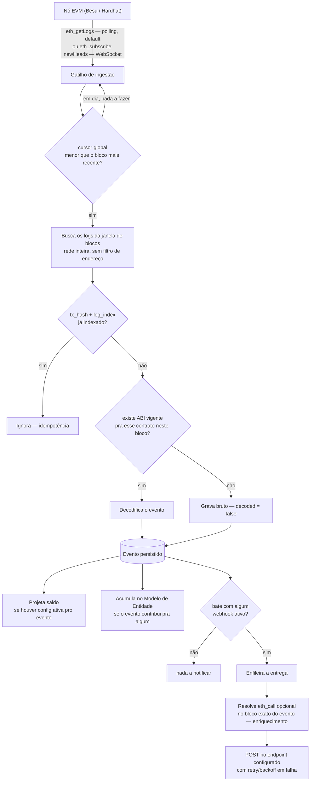
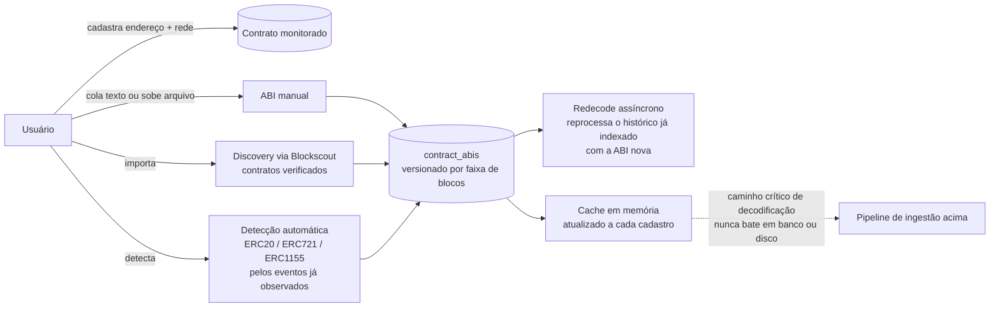

# Evex — EVM Event Indexer

API de indexação de eventos EVM **genérica e configurável**, para redes privadas Besu, instalável por
qualquer projeto/cliente BBChain sem reimplementar a camada de indexação — cadastro de contrato/ABI via
API, decodificação dinâmica em runtime (sem código gerado por contrato), saldos históricos, webhooks e
uma UI mínima. Ver [`base/indexer-product-draft.md`](base/indexer-product-draft.md) para o problema
completo, funcionalidades e escopo.

> **Status**: PoC em desenvolvimento incremental por etapas. Onde o projeto está agora, o que já foi
> feito e o que falta: [`docs/roadmap.md`](docs/roadmap.md). Por que cada decisão técnica foi tomada
> (log histórico, tipo ADR): [`docs/decisions.md`](docs/decisions.md).

## Para quem chega agora

- **Quer usar/testar o Evex?** → [`docs/guia-de-uso.md`](docs/guia-de-uso.md) — guia por cenário
  (cadastro de contrato/ABI, discovery, redecode, saldo, backfill, webhook, SSE ao vivo, aba
  Demonstração...), com prints. Inclui o modo mock do frontend (`npm run dev:mock`, roda sem backend).
- **Quer rodar o código?** → cada módulo abaixo tem um `README.md` próprio com o passo a passo.
- **É uma IA/agente trabalhando neste repositório?** → leia [`AGENTS.md`](AGENTS.md) **antes de
  responder qualquer coisa sobre o projeto ou tocar em código** — é o checklist de início de sessão,
  vale independente da ferramenta. Se a ferramenta for o Claude Code especificamente, leia também
  [`CLAUDE.md`](CLAUDE.md) (mesmo conteúdo do `AGENTS.md` + convenções específicas dessa ferramenta,
  como os agentes especializados em `.claude/agents/`).

## Módulos

| Módulo | O quê | Guia operacional | Contexto/decisões |
|---|---|---|---|
| [`backend/`](backend/) | API — Kotlin/Spring Boot, arquitetura hexagonal, OpenAPI-first | [`backend/README.md`](backend/README.md) | [`backend/CLAUDE.md`](backend/CLAUDE.md) |
| [`frontend/`](frontend/) | UI mínima da PoC — React/Vite/MUI | [`frontend/README.md`](frontend/README.md) | [`frontend/CLAUDE.md`](frontend/CLAUDE.md) |
| [`local-env/`](local-env/) | Ambiente local de teste (Hardhat + Blockscout + contratos de teste) — **não** faz parte do produto entregável, só valida o Evex ponta a ponta e serve pra demonstração | [`local-env/README.md`](local-env/README.md) | [`local-env/CLAUDE.md`](local-env/CLAUDE.md) |
| [`e2e/`](e2e/) | Suíte E2E (Playwright) — fluxos da UI mínima ponta a ponta contra a stack real — **não** faz parte do produto entregável | [`e2e/README.md`](e2e/README.md) | [`e2e/CLAUDE.md`](e2e/CLAUDE.md) |

## Como funciona — pipeline de ingestão

Um evento emitido na rede passa pelas mesmas etapas independente de o contrato estar cadastrado ou
não — **nenhum evento é descartado** (decisão de produto): sem ABI vigente, o evento fica gravado como
bruto (`decoded = false`) até alguém cadastrar a ABI depois, e o redecode assíncrono o decodifica
retroativamente.



## Como funciona — cadastro e versionamento de ABI

O que torna o Evex genérico: a ABI nunca é hardcoded. É cadastrada por 3 origens diferentes, guardada
versionada por faixa de blocos (suporta proxy upgradável — ABI antiga decodifica bloco antigo, ABI nova
decodifica bloco novo) e nunca sai da memória no caminho crítico de decodificação.



## Subindo tudo rapidamente

```bash
# 1. Postgres + backend
cd backend && docker compose up -d && ./gradlew bootRun

# 2. Ambiente de teste (nó EVM + contratos de exemplo) — ver local-env/README.md pro passo a passo completo
cd local-env && ./scripts/up.sh

# 3. Frontend
cd frontend && npm install && npm run dev
```

Frontend em `http://localhost:5173`, backend em `http://localhost:8080`. Detalhes, pré-requisitos e
variáveis de ambiente de cada módulo estão no `README.md` respectivo linkado na tabela acima.

## Decisões travadas mais importantes (resumo — lista completa no `docs/decisions.md`)

- **Rede inteira, sem filtro de endereço** no `eth_getLogs` — nenhum evento é descartado, a atribuição
  por endereço acontece na ingestão.
- **Polling é o gatilho default** (`eth_getLogs` agendado) — existe um gatilho alternativo por
  WebSocket (`eth_subscribe("newHeads")`, mesma lógica de ingestão por trás), trocável via
  `indexer.blockchain.transport` (E26/DEC-091). Validado ao vivo contra Hardhat real — 35–41ms de
  latência entre confirmar uma transação e o evento aparecer indexado — ver `docs/decisions.md`
  DEC-091.
- **Webhooks são feature separada** do pipeline de indexação — não é sobre a conexão com a rede.
- **Proxy upgradável suportado** — ABI versionada por faixa de blocos (`valid_from_block`/
  `valid_to_block`).
- **Sem autenticação/autorização** nesta fase — nenhuma camada de auth.
- **Uma instância por rede** (MAINNET | TESTNET) — segregação interna por campo `network`.

## Regras gerais (repositório inteiro)

- Identificadores de código em inglês; comentários/KDoc/commits em português (mesmo idioma da
  documentação).
- Ao terminar qualquer unidade de trabalho: atualizar `docs/roadmap.md` (status + notas de execução) e,
  se houve decisão técnica não trivial, `docs/decisions.md` (nova entrada). Vale tanto pra sessão
  principal quanto pra qualquer agente especializado.
