# Evex — guia de uso por cenário

> Guia prático de **como usar** o Evex, cenário a cenário. Para *o que é* e *por que* das decisões,
> ver [`../base/indexer-product-draft.md`](../base/indexer-product-draft.md) (produto) e
> [`decisions.md`](decisions.md) (ADR). Para *onde o projeto está*, ver [`roadmap.md`](roadmap.md).

O Evex é uma **API de indexação de eventos EVM genérica e configurável** para redes privadas. Você
cadastra os contratos que quer monitorar, dá a ABI de cada um, e o Evex:

- lê **todos** os eventos da rede por polling (`eth_getLogs` agendado, sem filtro de endereço),
- grava cada evento uma vez (idempotente por `tx_hash`+`log_index`),
- **decodifica** os eventos dos contratos que têm ABI cadastrada (os demais ficam "raw"),
- projeta **saldos históricos** de carteiras conforme regras que você define,
- dispara **webhooks** quando um evento decodificado bate com um filtro que você configurou.

Não há autenticação nesta PoC. Uma instância do Evex por rede/cliente; a segregação interna é pelo
campo `network` (`MAINNET` | `TESTNET`).

---

> As imagens deste guia são do **modo mock** (`npm run dev:mock`) — o front rodando sozinho, sem
> backend, com dados de exemplo. Ver [§0.1](#01-rodar-só-o-front-modo-mock-sem-backend).

## Índice

- [0. Subir o ambiente local](#0-subir-o-ambiente-local)
- [0.1. Rodar só o front (modo mock, sem backend)](#01-rodar-só-o-front-modo-mock-sem-backend)
- [1. Monitorar um contrato conhecido (cadastro + ABI colada)](#1-monitorar-um-contrato-conhecido-cadastro--abi-colada)
- [2. Descobrir e importar contratos via Blockscout](#2-descobrir-e-importar-contratos-via-blockscout)
- [3. Detectar automaticamente a interface (ERC20 / 721 / 1155)](#3-detectar-automaticamente-a-interface-erc20--721--1155)
- [4. Pegar eventos já gravados e decodificar (redecode do histórico)](#4-pegar-eventos-já-gravados-e-decodificar-redecode-do-histórico)
- [5. Monitorar saldo de carteiras ao vivo](#5-monitorar-saldo-de-carteiras-ao-vivo)
- [6. Backfill de saldo (config criada depois dos eventos)](#6-backfill-de-saldo-config-criada-depois-dos-eventos)
- [7. Configurar um webhook (notificação de saída)](#7-configurar-um-webhook-notificação-de-saída)
- [8. Os 3 modos de formulário (guiado / visual / manual)](#8-os-3-modos-de-formulário-guiado--visual--manual)
- [9. Acompanhar jobs assíncronos ao vivo (SSE)](#9-acompanhar-jobs-assíncronos-ao-vivo-sse)
- [10. Aba "Demonstração" — disparar scripts sem terminal](#10-aba-demonstração--disparar-scripts-sem-terminal)
- [11. Contrato proxy upgradável (ABI versionada por faixa de blocos)](#11-contrato-proxy-upgradável-abi-versionada-por-faixa-de-blocos)
- [12. Consultar saldo numa data / histórico](#12-consultar-saldo-numa-data--histórico)
- [Referência rápida](#referência-rápida)
- [Troubleshooting](#troubleshooting)

---

## 0. Subir o ambiente local

O `local-env/` é um ambiente descartável (Hardhat + Blockscout + 4 contratos de teste) só para
validar/demonstrar o Evex. **Não faz parte do produto.** Cada peça roda no seu próprio terminal.

```bash
# 0. Docker (WSL sem Docker Desktop)
docker info >/dev/null 2>&1 || sudo service docker start

# 1. Nó Hardhat — OBRIGATÓRIO em 0.0.0.0 (o Blockscout roda em container e não alcança 127.0.0.1)
cd local-env/local-env-scaffold-eth-2 && yarn chain --hostname 0.0.0.0

# 2. Contratos de teste + 1 round de eventos + Postgres do Evex + frontend + control-panel
cd local-env && ./scripts/up.sh

# 3. Backend do Evex (pela IDE, ou:)
cd backend && EVEX_RPC_URL=http://localhost:8545 EVEX_BLOCKSCOUT_URL=http://localhost:4001 ./gradlew bootRun

# 4. Blockscout — só para os cenários 2 e 3 (discovery / detecção via source verificado)
cd local-env && ./scripts/blockscout-up.sh
#    espere indexar: curl -s localhost:4001/api/v2/stats | grep total_blocks   (> 0)
npx tsx blockscout/verify-contracts.ts   # verifica TestERC20 e TestEventEmitter no Blockscout
```

| Peça | URL | Papel |
|---|---|---|
| Frontend do Evex | `http://localhost:5173` | UI mínima da PoC |
| Backend do Evex | `http://localhost:8080` | API (Swagger em `/swagger-ui.html`) |
| Nó Hardhat | `http://localhost:8545` | rede EVM local (chainId 31337) |
| Blockscout | `http://localhost:4001` | explorer real (discovery de ABI) |
| control-panel | `http://127.0.0.1:8899` | dispara os scripts do `local-env` (aba Demonstração) |
| Postgres do Evex | `localhost:5432` (`evex`/`evex`) | índice central |

**Para habilitar a aba "Demonstração"** no frontend, sirva-o com a variável setada (antes do `up.sh`,
ou rode o `npm run dev` você mesmo):

```bash
echo 'VITE_LOCALENV_CONTROL_URL=http://localhost:8899' >> frontend/.env.local
```

**Estado limpo:** para começar do zero, trunque as tabelas do Evex e **reinicie o backend por
completo** (Stop + Start — não HotSwap):

```bash
docker exec local-env-evex-postgres-1 psql -U evex -d evex -c \
  "DO \$\$ DECLARE r RECORD; BEGIN FOR r IN (SELECT tablename FROM pg_tables WHERE schemaname='public' AND tablename <> 'flyway_schema_history') LOOP EXECUTE 'TRUNCATE TABLE public.'||quote_ident(r.tablename)||' RESTART IDENTITY CASCADE'; END LOOP; END \$\$;"
```

O truncate **não** invalida o cache de ABIs em memória do backend (ver [DEC-070](decisions.md) e o
Troubleshooting) — por isso o restart completo é obrigatório numa rodada limpa.

---

## 0.1. Rodar só o front (modo mock, sem backend)

Para **demonstrar as telas** ou tirar prints sem subir Hardhat + Blockscout + backend + Postgres, o
frontend tem um **modo mock**: um Service Worker ([MSW](https://mswjs.io)) intercepta as chamadas da
API e responde com dados estáticos (`frontend/src/mocks/`). Nenhum código de produto muda — os mesmos
componentes rodam contra o cliente gerado.

```bash
cd frontend
npm ci
npm run generate:api   # 1x — gera o cliente TS (precisa de Java); já roda no dev/build/test normais
npm run dev:mock       # http://localhost:5173 — sem backend
```

- Dados de exemplo: 4 contratos (ERC20 com ABI, "Registro de Widgets" com ABI, "Coleção NFT ERC1155"
  **sem** ABI, "Cofre" proxy com 2 versões de ABI), ~14 eventos (decodificados + "sem ABI"), 2 configs
  de saldo, 2 webhooks com entregas, discovery Blockscout, sugestão de interface. **Recarregar a
  página zera o estado.**
- Mutações funcionam em memória: cadastrar contrato → aparece na lista; cadastrar ABI num contrato
  "sem ABI" → os eventos raw dele viram decodificados; pausar/ativar config; disparar backfill.
- A aba **"Demonstração"** aparece (o `control-panel` também é mockado) e o "Executar" mostra um output
  simulado.
- Os 2 streams SSE de status não são interceptáveis pelo MSW — o front cai pro polling do `/status`
  (que devolve "nada rodando"). É o mesmo caminho de degradação graciosa do [cenário 9](#9-acompanhar-jobs-assíncronos-ao-vivo-sse).

> **Não use o modo mock para validar integração** — ele não fala com a rede nem com o banco. É só
> para a camada visual. Para o fluxo ponta a ponta, suba a stack ([§0](#0-subir-o-ambiente-local)).

---

## 1. Monitorar um contrato conhecido (cadastro + ABI colada)

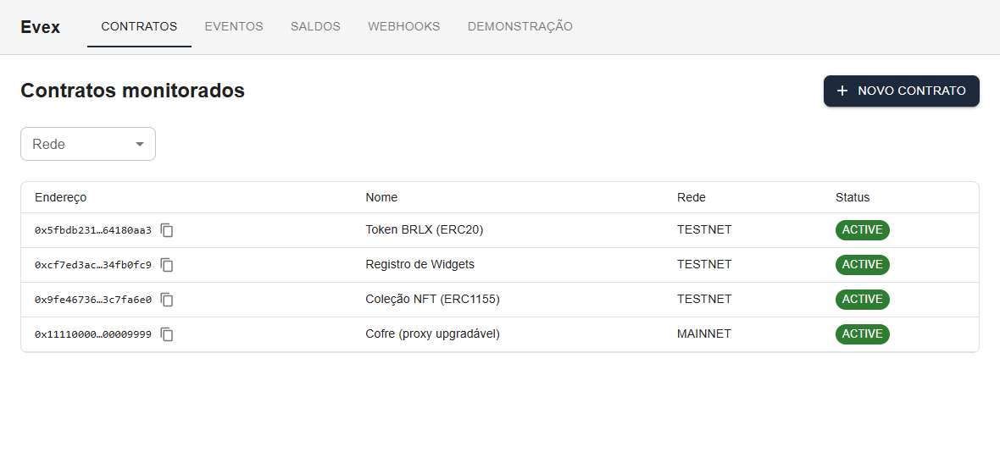

**Quando:** você sabe o endereço e tem a ABI em mãos (JSON).

1. **Contratos → "Novo contrato"**.
2. Preencha **Endereço** (`0x…`, 40 hex), **Nome**, **Rede** (`TESTNET` ou `MAINNET`). `Descrição` e
   `Versão` são opcionais.
3. **"Cadastrar"** → você vai para a tela de detalhe do contrato (`/contracts/<endereço>`).
4. Na seção **ABI → "Cadastrar nova versão"**:

   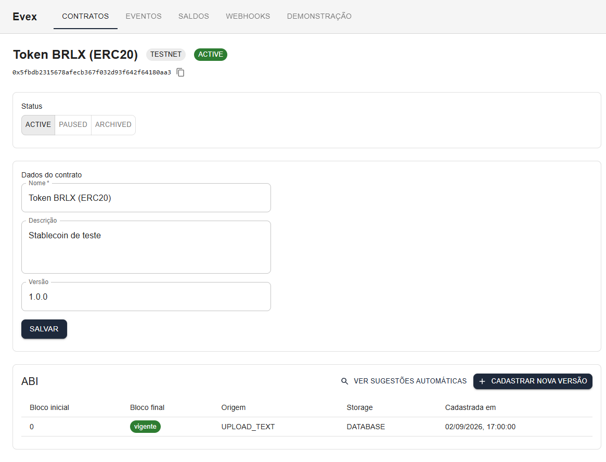

   - Origem **"Colar texto"** → cole o JSON da ABI (array de fragmentos; funções podem ficar, só os
     `type: "event"` importam para a decodificação).
   - **"Bloco inicial de validade"** — deixe `0` (default) para "vale desde sempre". Use outro valor
     só no cenário de proxy (cenário 11).
   - **"Cadastrar versão de ABI"**.
5. A tabela de versões ganha uma linha: `Bloco inicial 0` · `vigente` · `Origem UPLOAD_TEXT` ·
   `Storage DATABASE`.

**O que acontece nos bastidores:** ao cadastrar a ABI, o backend
(a) passa a **decodificar ao vivo** os novos eventos desse contrato na ingestão, e
(b) dispara um **redecode** dos eventos desse contrato que já estavam gravados como "raw" (cenário 4).

**Variações:**
- **ABI malformada** (`{ not json`) → a modal continua aberta e mostra erro `INVALID_ABI_CONTENT`.
- **Enviar arquivo `.abi`** em vez de colar → origem `UPLOAD_FILE`.
- **Status do contrato** (`ACTIVE` / `PAUSED` / `ARCHIVED`) — botões no topo do detalhe. `PAUSED` para
  de indexar eventos novos daquele contrato; a transição é livre nos dois sentidos.

**API equivalente:**
```
POST /v1/contracts            { address, name, network, description?, version? }
POST /v1/contracts/{address}/abi   { source: "UPLOAD_TEXT", abi: "<json>", validFromBlock?: 0 }
```

---

## 2. Descobrir e importar contratos via Blockscout

**Quando:** a rede tem um Blockscout com contratos **verificados** e você quer puxar endereço + ABI de
lá em vez de digitar.

*Pré-requisito:* `EVEX_BLOCKSCOUT_URL` setado no backend e o Blockscout indexando.

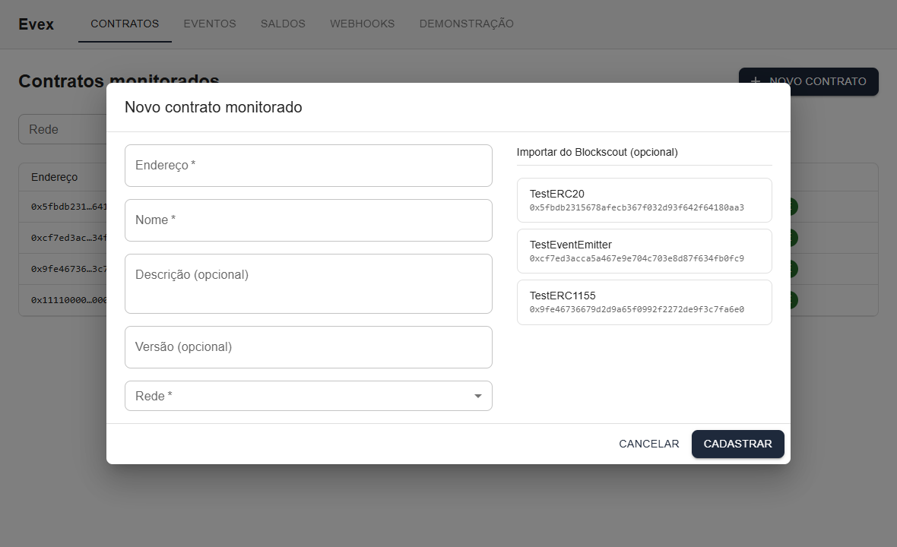

1. **Contratos → "Novo contrato"**. Na coluna **"Importar do Blockscout"** aparecem os contratos
   verificados (no local-env: `TestERC20`, `TestEventEmitter`).
2. Clique num item → **Endereço** e **Nome** do formulário são preenchidos automaticamente.
3. Escolha a **Rede** → **"Cadastrar"** → vai para o detalhe.
4. Na seção **ABI → "Cadastrar nova versão" → origem "Buscar no Blockscout" → "Cadastrar versão de
   ABI"**. O Evex busca a ABI direto do Blockscout.
5. A tabela de versões ganha uma linha com **origem `BLOCKSCOUT`**.

**Variação:** sem Blockscout no ar, a mesma coluna mostra *"Discovery via Blockscout não está
disponível"* (não é erro — o cadastro manual continua funcionando).

**API equivalente:**
```
GET  /v1/discovery/blockscout/contracts                # lista verificados
POST /v1/contracts/{address}/abi   { source: "BLOCKSCOUT" }
```

---

## 3. Detectar automaticamente a interface (ERC20 / 721 / 1155)

**Quando:** você não tem a ABI, mas o contrato já emitiu eventos e você suspeita que ele segue um
padrão conhecido (ERC20 / ERC721 / ERC1155).

O Evex compara os `topic0` dos primeiros logs observados com templates built-in.

1. Garanta que o contrato está **cadastrado sem ABI** e que já há eventos dele indexados (rode o
   cenário 10 "Disparar eventos de teste", ou espere o poller).
2. No detalhe do contrato → **"Ver sugestões automáticas" → "Detectar interfaces"**.
   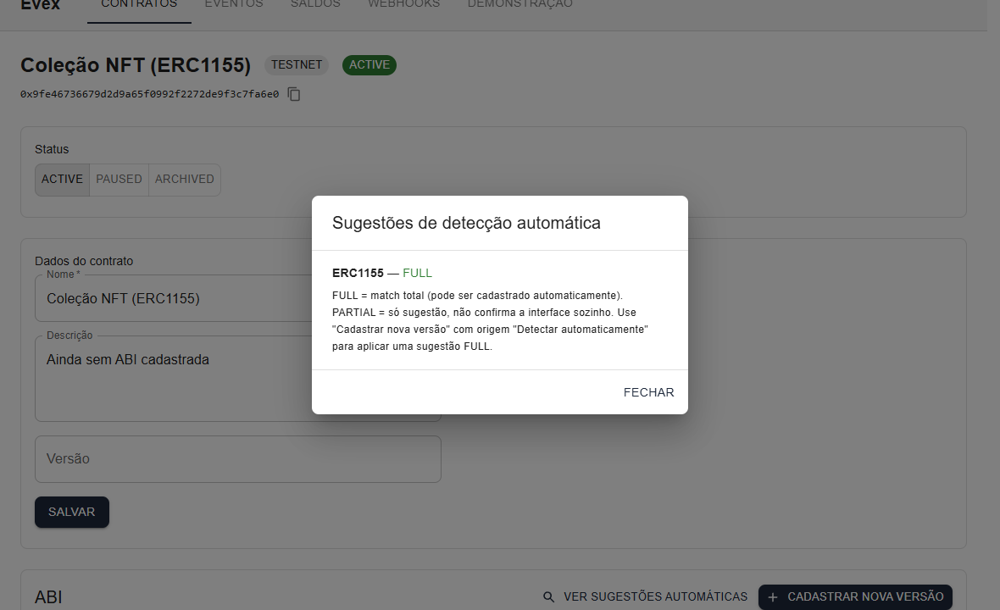

3. O Evex lista as interfaces reconhecidas com um **nível**:
   - **`FULL`** — todos os eventos do template batem. Dá para cadastrar a ABI automaticamente:
     feche a modal → **"Cadastrar nova versão" → origem "Detectar automaticamente" → "Detectar
     interfaces" → "Cadastrar versão de ABI"** → linha **`AUTO_DETECTED`** na tabela.
   - **`PARTIAL`** — match parcial. A UI **bloqueia** o cadastro automático e explica *"Nenhuma
     sugestão com match total"*. Use o cadastro manual (cenário 1).

**API equivalente:**
```
GET  /v1/contracts/{address}/abi/suggestions
POST /v1/contracts/{address}/abi   { source: "AUTO_DETECTED", templateName: "ERC20" }
```

---

## 4. Pegar eventos já gravados e decodificar (redecode do histórico)

**⭐ O fluxo central do produto** ("indexar tudo primeiro, decodificar depois").

**Cenário:** o poller ingeriu eventos de um contrato **antes** de você cadastrar a ABI dele. Esses
eventos ficaram gravados como **"raw"** (topics + data brutos, sem nome nem parâmetros). Ao cadastrar
a ABI, o Evex **reprocessa** esses eventos já gravados e os transforma em decodificados — **sem tocar
a rede de novo** (os logs de blocos confirmados são imutáveis, o `RawLog` é reconstruído do banco).

**Passo a passo (UI):**

1. Cadastre o contrato **sem ABI** (cenário 1, pare no passo 3). Deixe o poller ingerir eventos (ou
   dispare-os pela aba Demonstração — cenário 10).
2. **Eventos** → filtre por esse contrato → as linhas mostram o chip **"sem ABI"** (laranja) na
   coluna *Evento*. A coluna *Contrato* mostra o nome com link para o detalhe (contrato monitorado)
   ou o endereço encurtado (não monitorado).

   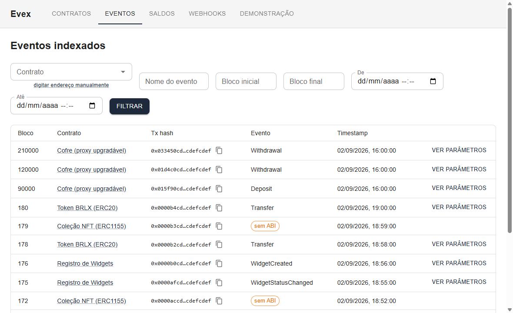
3. Volte ao detalhe do contrato → cadastre a ABI (colar / Blockscout / detectar).
4. **Sem recarregar a página**, um indicador *"Decodificando o histórico… (N processados)"* aparece
   na seção ABI enquanto o redecode roda, e some sozinho ao terminar (cenário 9 — via SSE).
5. Volte em **Eventos**, filtre pelo mesmo contrato → as **mesmas linhas** agora mostram o **nome do
   evento** (ex.: `Transfer`, `WidgetCreated`). Clique em **"ver parâmetros"** para ver a tabela de
   parâmetros decodificados (`from` / `to` / `value` etc.).

   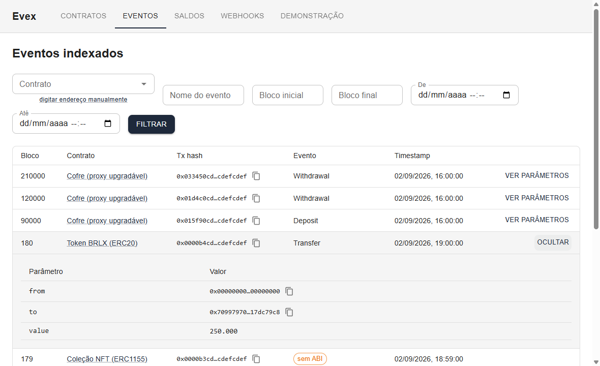

> **Nota de ambiente:** num local-env pequeno (dezenas de eventos por contrato), o redecode termina
> em menos de 2 segundos — o indicador pode piscar rápido demais para ser notado. O mecanismo está
> correto; o efeito é só de escala.

**Filtros da tela de Eventos:** contrato (autocomplete de monitorados **ou** "digitar endereço
manualmente" para um endereço fora da lista), nome do evento (catálogo do contrato quando há um
monitorado selecionado; texto livre no modo manual), faixa de blocos, faixa de datas.

**Redecode manual (opcional):** `POST /v1/redecode` dispara um redecode global de tudo que está
pendente (`decoded=false`). `GET /v1/redecode/status` devolve `{ running, processedCount,
decodedCount, remainingCount }`.

---

## 5. Monitorar saldo de carteiras ao vivo

**Quando:** você quer que o Evex mantenha o saldo de token de cada carteira, derivado dos eventos.

O Evex **não** consulta `balanceOf` na rede — ele **projeta** o saldo a partir dos eventos
decodificados, conforme uma **configuração de monitoramento** que você define por contrato+evento.

**Comportamentos (`behavior`):**

| `behavior` | Efeito no saldo | Exemplo | Parâmetros exigidos |
|---|---|---|---|
| `CREDIT` | sempre **soma** | `TokenMinted(recipient, amount)` | `walletParam`, `valueParam` |
| `DEBIT` | sempre **subtrai** | `TokenBurned(holder, amount)` | `walletParam`, `valueParam` |
| `TRANSFER` | **deduz** de um endereço e **credita** em outro | `Transfer(from, to, value)` | `fromParam`, `toParam`, `valueParam` |
| `DELTA` | o parâmetro **já é** o delta (pode ser negativo) | `BalanceUpdated(wallet, int256 delta)` | `walletParam`, `valueParam` |

`tokenIdParam` é opcional — use para ERC1155 / ERC721 (o saldo passa a ser por `(carteira, contrato, tokenId)`).

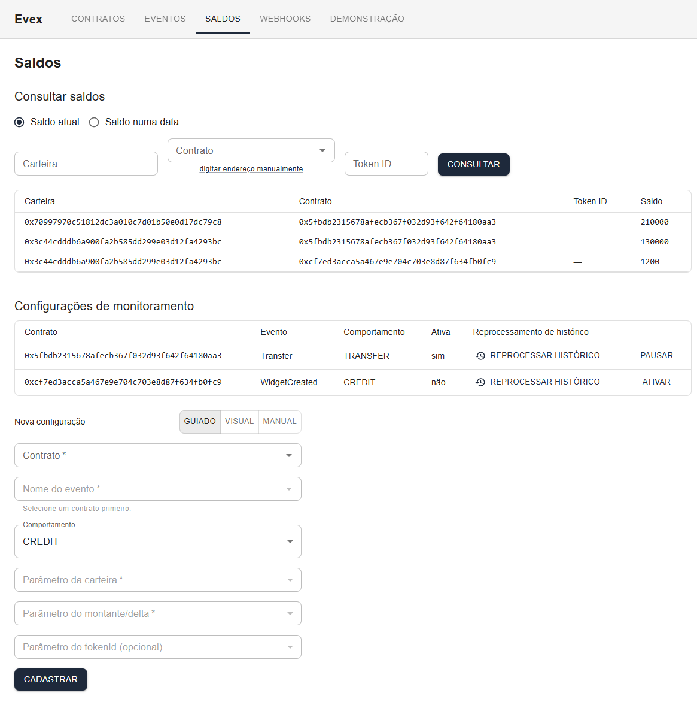

**Passo a passo (UI, modo guiado):**

1. Garanta o contrato **com ABI** (para o catálogo de eventos e a decodificação ao vivo).
2. **Saldos → "Configurações de monitoramento" → "Nova configuração"**:
   - **Contrato** — escolha no autocomplete. **Não há campo "Rede"**: ela é **herdada** do contrato.
   - **Nome do evento** — escolha no catálogo (`<EventPicker>`, alimentado por
     `GET /v1/contracts/{address}/events`).
   - **Comportamento** — `CREDIT` / `DEBIT` / `TRANSFER` / `DELTA`. Os campos de parâmetro abaixo
     mudam conforme a escolha.
   - **Parâmetros** — cada um é um select filtrado por tipo: "Parâmetro da carteira" só lista os
     inputs `address` do evento; "Parâmetro do montante/delta" só lista os numéricos; etc.
3. **"Cadastrar"** → *"Configuração cadastrada com sucesso."* + linha na tabela.
4. Dispare eventos (mint etc.) e espere decodificar. Em **"Consultar saldos"**, filtre por
   **Carteira** + **Contrato** → aparece a linha com o saldo projetado.
5. Na tabela de configs: **"Pausar"** → coluna *Ativa* vira "não" (a projeção para de considerar
   novos eventos dessa config); **"Ativar"** volta.

**Ordem importa:** a projeção ao vivo só considera eventos que chegam **depois** da config existir (e
serem decodificados). Para incorporar histórico anterior, veja o cenário 6.

**API equivalente:**
```
GET  /v1/contracts/{address}/events           # catálogo de eventos (nome + inputs tipados)
POST /v1/balance-monitors    { contractAddress, network, eventName, behavior,
                               walletParam?|fromParam?+toParam?, valueParam, tokenIdParam?, active? }
GET  /v1/balances?walletAddress=&contractAddress=&tokenId=
PATCH /v1/balance-monitors/{id}/status   { active: false }
```

---

## 6. Backfill de saldo (config criada depois dos eventos)

**Cenário:** você criou a config de saldo **depois** que o histórico já foi indexado e decodificado.
A projeção ao vivo não volta atrás → `GET /v1/balances` fica vazio para esse par até você rodar o
backfill.

O **backfill** reprojeta os eventos **já indexados e decodificados** abaixo da "marca d'água" da
config (o bloco do cursor de indexação no momento da criação da config) contra ela — **sem
reconsultar a rede**. É um job global assíncrono em lotes (um por instância, DEC-068), resumível e
exactly-once (cursor `(block, logIndex)` persistido na config).

**Passo a passo (UI):**

1. Cenário: contrato **com ABI** e histórico já decodificado (cenário 4), **depois** você cria a
   config de saldo (cenário 5).
2. Consulte o saldo → **vazio**.
3. Na linha da config, botão **"Reprocessar histórico"**.
4. Aparece o progresso inline: *"processados N · deltas N · restam N"* + barra; ao terminar, *"Reprocessamento concluído."*.
5. Consulte o saldo de novo → agora aparece, com o valor certo.
6. Clicar **"Reprocessar histórico"** de novo → **no-op** (o saldo não muda; `GET
   /v1/balance-monitors/backfill/status` reporta `caughtUp: true`).

**Enquanto um backfill de OUTRA config roda,** o botão das demais fica desabilitado com o aviso
*"Há um reprocessamento de outra configuração em andamento"* (job global, DEC-068).

**API equivalente:**
```
POST /v1/balance-monitors/{id}/backfill
GET  /v1/balance-monitors/backfill/status   # { running, configId, processedCount, deltaCount, remainingCount, caughtUp }
```

---

## 7. Configurar um webhook (notificação de saída)

**Quando:** você quer que um sistema externo receba um `POST` sempre que um evento decodificado bate
com um filtro.

Webhooks **não** têm a ver com a conexão com a rede (que é só polling). É notificação de **saída**:
evento decodificado → bate com a config → `POST` no endpoint que você configurou → fila com retry e
log de tentativas.

**Passo a passo (UI, modo guiado):**

1. Contrato **com ABI**.
2. **Webhooks → "Novo webhook"**:
   - **Contrato** + **Nome do evento** (catálogo) — rede herdada, igual ao saldo.
   - **URL de destino** — para onde vai o `POST`.
   - **Filtros (opcional)** — "adicionar filtro" → escolha o **parâmetro** (select por tipo),
     **operador** (`GT`/`GTE`/`LT`/`LTE`/`EQ`/`NEQ` — comparação numérica quando possível, senão
     string) e **valor**. Só dispara quando **todos** os filtros passam.
   - **Template de payload (opcional)** — ver abaixo. Sem template, o Evex manda o envelope padrão.
3. **"Cadastrar"** → *"Webhook cadastrado com sucesso."*.
4. Clique na linha para abrir o **detalhe** do webhook.
5. Dispare um evento que bate com o filtro → espere decodificar → na seção **"Entregas"** aparece uma
   linha; status **`PENDING` → `DELIVERED`** (ou `FAILED` se esgotar as tentativas). **"ver
   tentativas"** mostra cada tentativa com o HTTP status e o corpo.

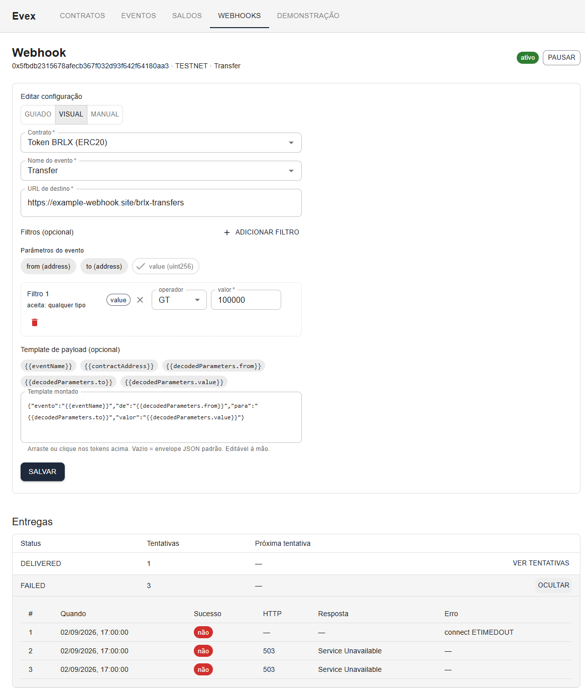

**Envelope padrão** (quando `payloadTemplate` é nulo):
```json
{
  "contractAddress": "0x…", "network": "TESTNET", "eventName": "Transfer",
  "blockNumber": 123, "blockHash": "0x…", "txHash": "0x…", "logIndex": 0,
  "blockTimestamp": "2026-09-02T…Z",
  "decodedParameters": { "from": "0x…", "to": "0x…", "value": "1000" }
}
```

**Template customizado** — interpolação simples de `{{campo}}` e `{{decodedParameters.<nome>}}`.
Campos fixos: `{{eventName}}`, `{{contractAddress}}`, `{{network}}`, `{{blockNumber}}`, `{{txHash}}`,
`{{blockHash}}`, `{{logIndex}}`, `{{blockTimestamp}}`. No modo **visual** há um construtor com botões
que inserem os tokens. Exemplo:
```json
{"evento": "{{eventName}}", "de": "{{decodedParameters.from}}", "valor": "{{decodedParameters.value}}"}
```
Template malformado é rejeitado **no cadastro** (não silenciosamente no primeiro disparo).

**API equivalente:**
```
POST /v1/webhooks   { contractAddress, network, eventName, url,
                      filters?: [{ paramName, operator, value }], payloadTemplate?, active? }
GET  /v1/webhooks/{id}/deliveries
PATCH /v1/webhooks/{id}/status   { active: false }
```

---

## 8. Os 3 modos de formulário (guiado / visual / manual)

Os formulários de **saldo**, **webhook** e o **filtro de eventos** têm um seletor de modo
(`Guiado / Visual / Manual`). A escolha **persiste no reload** (por formulário, `localStorage`).

| Modo | Como funciona | Quando usar |
|---|---|---|
| **Guiado** (default) | Selects em cascata sobre os dados cadastrados: contrato → evento (catálogo) → parâmetros (filtrados por tipo). Rede herdada do contrato. | O caminho normal — contrato conhecido, você não digita endereço nem nome de parâmetro. |
| **Visual** | Um **canvas** com os parâmetros do evento como "chips" arrastáveis (ou clicáveis) que você vincula aos "slots" (Carteira, Montante, Origem, Destino…). Recusa vínculo de tipo incompatível. Para webhook, inclui o construtor de `payloadTemplate` por clique. | Apresentar o mapeamento de forma explícita; explorar o que cada evento oferece. |
| **Manual** | Campos de texto livre (endereço, nome do evento, nomes de parâmetro) + `<NetworkSelect>` explícito. É o comportamento pré-E16. | Evento que **não está no catálogo** (ex.: contrato sem ABI ainda, ou um evento que você quer filtrar antes de decodificar), ou integração via colar/copiar. |

Os 3 modos montam **o mesmo payload** — a diferença é só a forma de preencher.

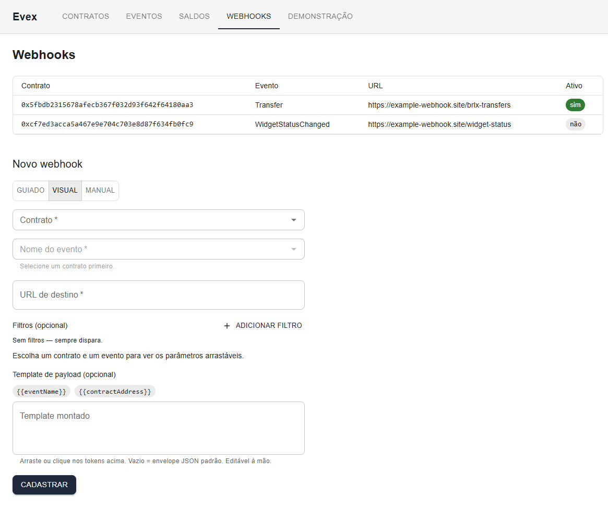

**Herança de rede:** nos modos guiado/visual, escolher um contrato cadastrado **remove** o campo
"Rede" — ela vem do `ContractRef`. Não dá para submeter com rede vazia.

---

## 9. Acompanhar jobs assíncronos ao vivo (SSE)

O status dos jobs assíncronos (**redecode** do cenário 4, **backfill** do cenário 6) é **empurrado**
do backend para o front em tempo real via **Server-Sent Events**, sem polling e sem recarregar a
página.

- **Tela do contrato** (`/contracts/<endereço>`) assina `GET /v1/redecode/status/stream`. Enquanto um
  redecode global roda, aparece `<CircularProgress>` + *"Decodificando o histórico… (N processados)"*
  na seção ABI — em **qualquer** tela de contrato (o redecode é global, o texto é genérico de
  propósito). Some sozinho quando termina.
- **Tela de Saldos** (`/balances`) assina `GET /v1/balance-monitors/backfill/status/stream`. O
  progresso inline (`processados · deltas · restam` + barra) chega por esse stream — abra `/balances`
  em duas abas e dispare o backfill numa: a outra atualiza ao vivo.

**Frames SSE:** `event: status` (o mesmo DTO dos endpoints REST `/status`), `event: heartbeat` (a
cada ~15s, mantém a conexão), `event: done` (quando o job vai de `running: true → false`).

**Degradação graciosa:** se o backend cair com o stream aberto, o `EventSource` detecta e o front
**cai para polling** do endpoint REST `/status` correspondente (1,5s) — a UI não quebra. Quando o
backend volta, as telas com polling (`/balances`, `/contracts/:addr`) se recuperam sozinhas; telas de
query pura (`/events`) mostram *"Network Error"* até a próxima ação (Filtrar / reload). O
`EventSource` **não** re-assina sozinho para o mesmo path após um erro (ver [DEC-074](decisions.md)
complemento) — em sessão de demo (< 30 min) isso não incomoda.

Os 2 endpoints `/stream` **não** entram no cliente TypeScript gerado (o `openapi-generator` não
modela `text/event-stream`) — são consumidos via `EventSource` nativo. É a exceção da
[DEC-078](decisions.md) à regra "OpenAPI-first".

---

## 10. Aba "Demonstração" — disparar scripts sem terminal

**Só aparece** quando `VITE_LOCALENV_CONTROL_URL` está setado **e** o `local-env/control-panel`
responde ao health check. **Não faz parte do produto** — é ferramenta de demonstração local.

Cada card mostra **o comando exato que vai rodar**, antes de executar, e exibe o output ao vivo num
`<pre>` + um chip de status (`rodando` / `exit 0` / `exit N` / `falhou`).

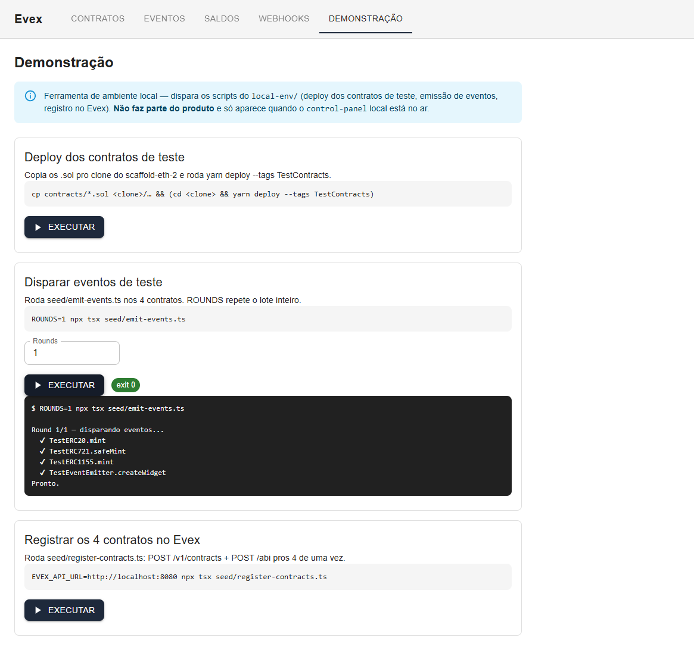

| Card | O que faz |
|---|---|
| **Deploy dos contratos de teste** | Copia os `.sol` de `local-env/contracts/` para o clone do scaffold-eth-2 e roda `yarn deploy --tags TestContracts`. |
| **Disparar eventos de teste** | Roda `seed/emit-events.ts`: `mint`/`safeMint`/`mintBatch`/`createWidget`/`changeStatus`/`processBatch` nos 4 contratos. Campo **Rounds** repete o lote inteiro (gera volume / testa paginação). |
| **Registrar os 4 contratos no Evex** | Roda `seed/register-contracts.ts`: `POST /v1/contracts` + `POST /abi` para os 4 de uma vez (estado "tudo cadastrado" sem clicar). |

**Uma ação por vez:** disparar uma segunda ação enquanto a primeira roda → **HTTP 409**, renderizado
como alerta *"Já há uma ação em execução no control-panel — aguarde ela terminar."*. Fechar a aba no
meio de uma execução mata o processo filho (não deixa órfão).

Fluxo típico de demo: **Disparar eventos** (Rounds=2) → ver os eventos entrando em `/events` →
cadastrar a ABI de um contrato pela UI → ver o redecode (cenário 4).

---

## 11. Contrato proxy upgradável (ABI versionada por faixa de blocos)

**Cenário:** um proxy (ex.: `ERC1967Proxy`) cujo comportamento — e portanto a ABI dos eventos — muda
num bloco de upgrade. Eventos antigos precisam ser decodificados com a ABI **da época**, os novos com
a atual.

O Evex versiona `contract_abis` por **faixa de blocos** por endereço: cada versão tem
`validFromBlock` e `validToBlock` (aberto = `null`, "vigente"). Ao decodificar um evento, o Evex
escolhe a versão cuja faixa contém `event.blockNumber`.

**Contrato real pra testar isso** (não precisa simular): `local-env/contracts/` tem um proxy UUPS/
ERC1967 de verdade — `TestUpgradeableVaultV1.sol` (evento `Deposited`) → upgrade → `V2.sol` (mantém
`Deposited`, acrescenta `Withdrawn`) — e 2 scripts que fazem o deploy/upgrade de ponta a ponta
(`local-env/README.md` §3.9, também disponíveis na aba "Demonstração"):

```bash
cd local-env
npx tsx seed/deploy-upgradeable-vault.ts     # implementação V1 + proxy inicializado + 2 deposit()
npx tsx seed/upgrade-upgradeable-vault.ts    # implementação V2 + upgradeToAndCall + deposit()+withdraw()
```

**Passo a passo (UI):**

1. Rode `deploy-upgradeable-vault.ts`. Cadastre o contrato no Evex com o **endereço do proxy** que o
   script imprime (não o da implementação) e cole o conteúdo de `.logs/vault-v1-abi.json` na tela
   "Cadastrar ABI" com `Bloco inicial de validade = 0`.
2. Rode `upgrade-upgradeable-vault.ts`. Ele upgrada o mesmo proxy pra V2 e imprime o bloco `B` exato da
   transação de upgrade. Cadastre a **nova versão** da ABI (conteúdo de `.logs/vault-v2-abi.json`) com
   **`Bloco inicial de validade = B`**. O Evex fecha automaticamente a versão anterior em `B - 1`.
3. A tabela de versões passa a mostrar duas linhas: `[0 … B-1]` e `[B … vigente]`.

   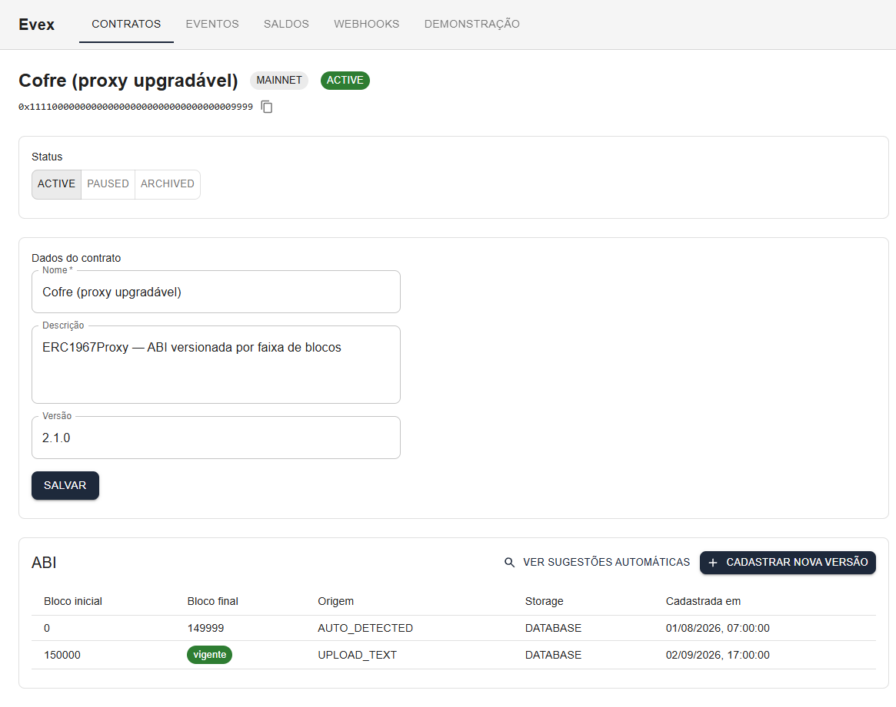
4. `POST /v1/redecode` (ou o redecode automático do cadastro) reprocessa cada evento contra a versão
   correta para o bloco dele. Confirme em `GET /v1/events`: os blocos antes de `B` só têm `Deposited`,
   os de `B` em diante podem ter `Deposited` **e** `Withdrawn`.

**Regra:** a versão aberta (`validToBlock = null`) exige `validFromBlock` estritamente crescente a
cada novo cadastro — cadastrar uma versão com bloco ≤ ao da vigente devolve `400
ABI_VERSION_ORDER_INVALID`.

---

## 12. Consultar saldo numa data / histórico

Na tela **Saldos → "Consultar saldos"**, o rádio **"Saldo numa data"** consulta o saldo projetado
**como estava** numa data/hora — a partir dos snapshots diários (`asset_balance_snapshots`,
consolidados por um job `@Scheduled` noturno) + os eventos desde o último snapshot.

- **"Saldo atual"** → `GET /v1/balances?walletAddress=&contractAddress=&tokenId=`
- **"Saldo numa data"** → `GET /v1/balances/history?walletAddress=&contractAddress=&date=<YYYY-MM-DD>`

Sem carteira ou contrato preenchido, a consulta traz a página inteira (útil para inspeção).

---

## Referência rápida

### Telas (UI mínima — doc §6)

| Rota | Tela |
|---|---|
| `/contracts` | Lista + cadastro de contratos monitorados |
| `/contracts/<endereço>` | Detalhe: status, dados, seção ABI (versões + cadastro), sugestões automáticas |
| `/events` | Eventos indexados com filtros (contrato, evento, blocos, datas) + "ver parâmetros" |
| `/balances` | Consulta de saldo (atual / por data) + configs de monitoramento + backfill |
| `/webhooks` · `/webhooks/<id>` | Lista/cadastro + detalhe com entregas e tentativas |
| `/demo` | Aba "Demonstração" (só com `VITE_LOCALENV_CONTROL_URL` + control-panel no ar) |

### Enums

| Enum | Valores |
|---|---|
| `network` | `MAINNET`, `TESTNET` |
| `contractStatus` | `ACTIVE`, `PAUSED`, `ARCHIVED` |
| `abiSource` | `UPLOAD_FILE`, `UPLOAD_TEXT`, `BLOCKSCOUT`, `AUTO_DETECTED` |
| `abiStorageType` | `DATABASE`, `LOCAL`, `HYBRID` (default `DATABASE` — `indexer.abi-storage.default`) |
| `detectionLevel` | `FULL` (aplica), `PARTIAL` (só sugere) |
| `balanceBehavior` | `CREDIT`, `DEBIT`, `TRANSFER`, `DELTA` |
| `filterOperator` | `GT`, `GTE`, `LT`, `LTE`, `EQ`, `NEQ` |
| `webhookDeliveryStatus` | `PENDING`, `DELIVERED`, `FAILED` |

### Endpoints principais

```
# Contratos e ABI
GET/POST   /v1/contracts
GET/PATCH  /v1/contracts/{address}
PATCH      /v1/contracts/{address}/status
GET/POST   /v1/contracts/{address}/abi
GET        /v1/contracts/{address}/abi/suggestions
GET        /v1/contracts/{address}/events           # catálogo p/ os forms guiados
GET        /v1/discovery/blockscout/contracts       # discovery

# Eventos e redecode
GET        /v1/events?contractAddress=&eventName=&fromBlock=&toBlock=&fromDate=&toDate=
POST       /v1/redecode                             # redecode global (filtro opcional)
GET        /v1/redecode/status
GET        /v1/redecode/status/stream               # SSE (fora do cliente gerado)

# Saldos
GET/POST   /v1/balance-monitors
GET/PATCH  /v1/balance-monitors/{id}
PATCH      /v1/balance-monitors/{id}/status
POST       /v1/balance-monitors/{id}/backfill
GET        /v1/balance-monitors/backfill/status
GET        /v1/balance-monitors/backfill/status/stream   # SSE
GET        /v1/balances?walletAddress=&contractAddress=&tokenId=
GET        /v1/balances/history?walletAddress=&contractAddress=&date=YYYY-MM-DD

# Webhooks
GET/POST   /v1/webhooks
GET/PATCH  /v1/webhooks/{id}
PATCH      /v1/webhooks/{id}/status
GET        /v1/webhooks/{id}/deliveries
```

Swagger UI completo em `http://localhost:8080/swagger-ui.html`.

---

## Troubleshooting

| Sintoma | Causa / correção |
|---|---|
| **Cadastrei a ABI mas os eventos históricos continuam "sem ABI"** | Redecode não rodou, ou a ABI tem `validFromBlock` acima do bloco dos eventos. Rode `POST /v1/redecode`; confira a faixa de validade da versão (cenário 11). |
| **Eventos aparecem decodificados mesmo com `contract_abis` vazio, logo após truncar o banco** | O `AbiCache` em memória do backend **sobrevive** ao truncate (populado no boot, sem evict — [DEC-070](decisions.md)). Faça **Stop + Start** completo do backend (não HotSwap / "Update classes" da IDE). |
| **Poller parado / cursor à frente do head da cadeia** | Se você reiniciou o `yarn chain` (blocos voltam ao 0) sem truncar o Evex, o cursor de indexação fica à frente. Trunque as tabelas do Evex (`ingestion_cursor` incluso) e reinicie o backend. |
| **`GET /v1/contracts?size=500` → 400 `VALIDATION_ERROR`** | O parâmetro `size` tem `maximum: 200` na spec. O front respeita isso ([DEC-072](decisions.md) complemento); se você chamar a API na mão, use `size ≤ 200`. |
| **Blockscout `total_blocks: 0`** | O nó Hardhat está em `127.0.0.1` — reinicie com `--hostname 0.0.0.0`, depois `blockscout-up.sh` + `verify-contracts.ts`. |
| **Aba "Demonstração" não aparece** | `VITE_LOCALENV_CONTROL_URL` não setado no frontend, ou o `control-panel` fora do ar (`curl localhost:8899/health`). O `up.sh` sobe o control-panel; a env var precisa estar no `.env.local` **antes** do `npm run dev`. |
| **Webhook não dispara** | (a) o evento não decodificou (ABI faltando); (b) um filtro não passou; (c) o webhook está `PAUSED`; (d) o evento chegou **antes** do webhook existir (não há backfill de webhook — só redecode reenfileira). |
| **`EPIPE` em `verify-contracts.ts`** | Blockscout ainda subindo (`total_blocks: 0`). Espere ~90s e rode de novo. |
| **Config de saldo não projeta o histórico** | Esperado — a projeção ao vivo só pega eventos posteriores à config. Use o backfill (cenário 6). |

---

*Última revisão: 2026-09-02 (E16 + E17). Ver `roadmap.md` para o estado das etapas.*
